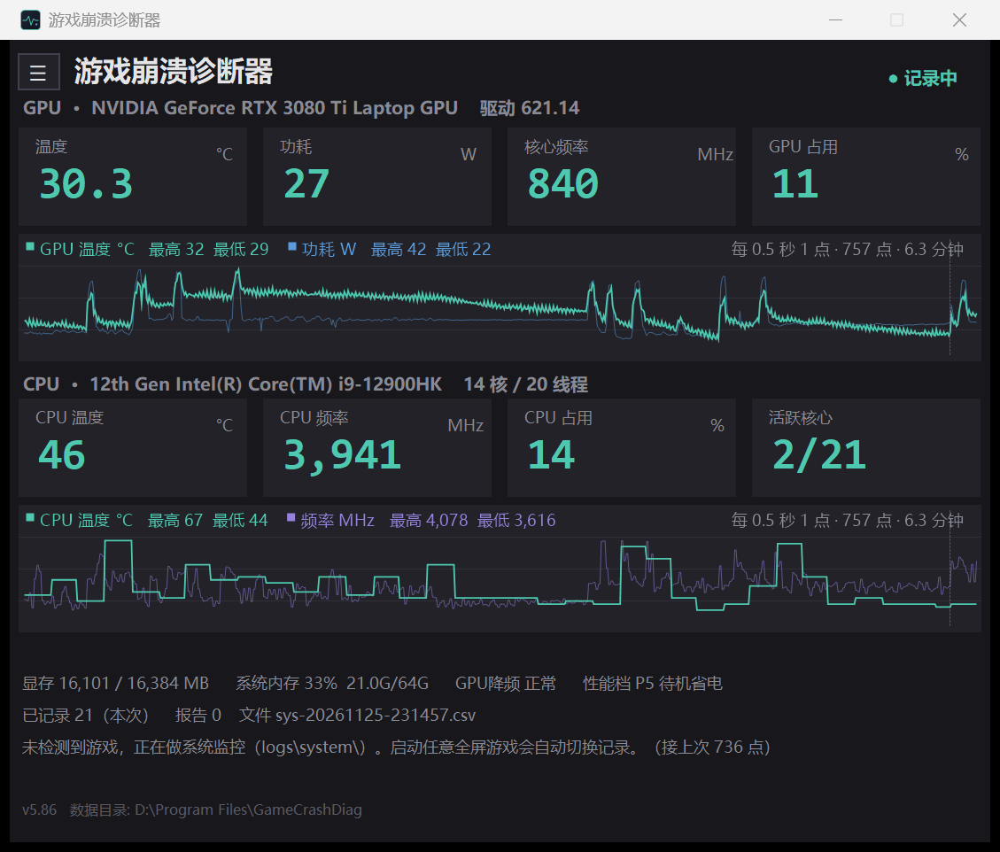
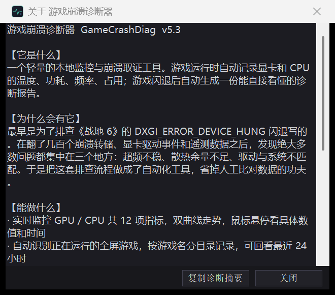
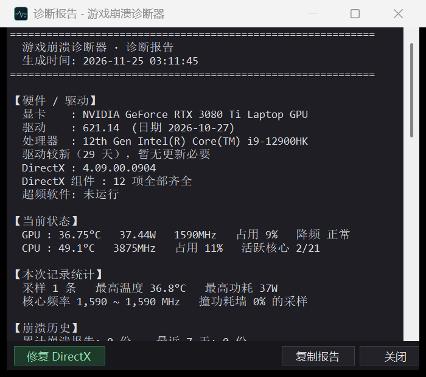
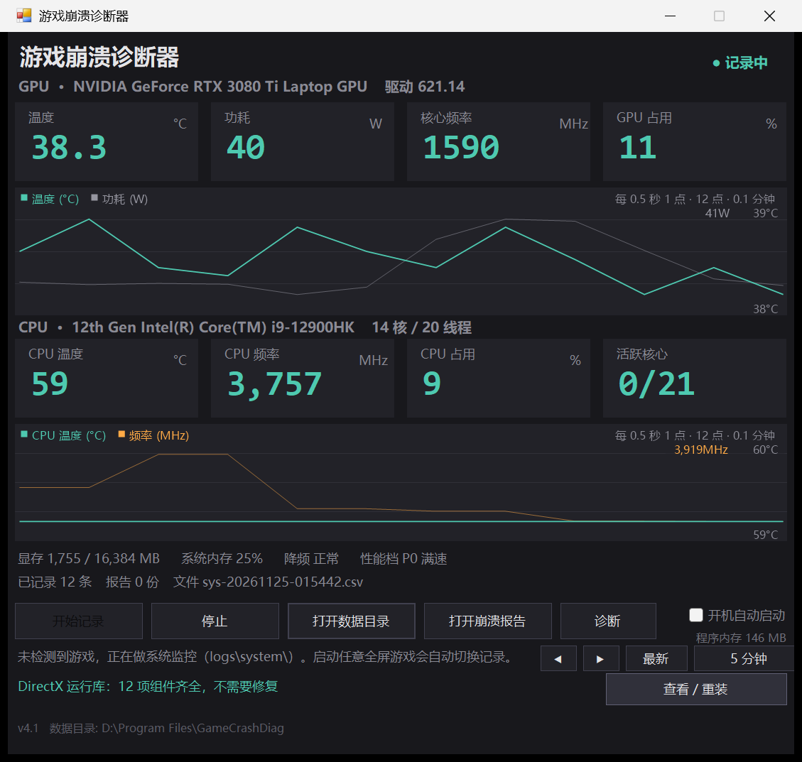

# 游戏崩溃诊断器 · GameCrashDiag

> 仓库地址： <https://github.com/zoesion/game-crash-diag>

**English** · A Windows desktop tool that watches GPU/CPU temperature, power and clocks while you play,
and turns a game crash into a report you can actually act on: error-code explanations, an idle-vs-in-game
thermal baseline, and concrete next steps. Chinese UI and reports by default; English is available in-app.

**中文** · 一个 Windows 桌面小工具：玩游戏时实时记录显卡和 CPU 的温度、功耗、频率，游戏崩溃后自动生成
一份能看懂的诊断报告 —— 错误码解读、空闲与游戏内温度基线对比、以及具体的处理建议。界面和报告支持中英双语。







> 任意游戏运行时 GPU / CPU 实时监控与崩溃取证工具 —— 专治 `DXGI_ERROR_DEVICE_HUNG` 这类 DX 报错。

**英文名 / 仓库名：GameCrashDiag / game-crash-diag**

一个 PowerShell + WinForms 写的桌面小工具，**零依赖、不需安装运行时**，Windows 自带 PowerShell 就能跑。
游戏运行时自动记录显卡和处理器状态，崩溃时自动生成带现场数据的报告，用来定位到底是超频、散热、驱动还是硬件的问题。



---

## 为什么做这个

战地6 的 DX 崩溃（`0x887A0006` / `0x887A0005`）最恶心的地方在于：崩完什么都没留下。
系统事件日志只说"驱动出错了"，游戏只给你一个弹窗，**崩溃前那一刻的功耗、频率、温度全部丢失**。

这个工具做的就是补上这段空白：

1. 每 0.5 秒采一次 GPU + CPU 状态，落盘成 CSV
2. 游戏进程消失时，自动判定是崩溃还是正常退出
3. 崩溃则生成报告：崩溃前 40 条遥测 + 前后 10 分钟系统事件 + 应用错误 + 系统配置

---

## 特性

| 能力 | 说明 |
|---|---|
| **GPU 实时监控** | 温度 / 功耗 / 核心频率 / 占用率 / 显存 / 降频原因 |
| **CPU 实时监控** | 温度 / 实际频率 / 占用率 / 活跃核心数 |
| **双走势图** | 上图 GPU（青=温度 蓝=功耗），下图 CPU（青=温度 紫=频率），带颜色图例与最高/最低 |
| **6 小时缓存** | 每张图保留 43,200 个采样点（500ms 采样 ≈ 6 小时），默认显示最近 10 分钟，可拖动回看 |
| **鼠标悬停读数** | 鼠标移到曲线图上出现红色竖线，提示框显示该点的数值与时刻 |
| **自动记录** | 检测到**任意全屏游戏**自动开始（不需要游戏名单），退出自动结算 |
| **日志分流** | 游戏时写 `logs\<游戏名>\`，不打游戏时写 `logs\system\`，互不污染 |
| **崩溃取证** | 自动区分「崩溃」和「正常退出」，只对真崩溃告警 |
| **通用模式** | 没有 N 卡也能跑（AMD / Intel 核显），自动降级 |
| **进阶脚本** | 取证包收集、minidump 解析、功耗墙调节、系统修复 |

---

## 环境要求

- Windows 10 / 11
- PowerShell 5.1（系统自带，无需安装）
- **NVIDIA 显卡**可获完整数据；AMD / Intel 走通用模式（只有占用率和显存）

---

## 安装

### 方式一：安装脚本（推荐）

1. 下载或解压本仓库
2. 双击 **`安装.cmd`**
3. 默认装到 `D:\Program Files\GameCrashDiag`，**不需要管理员权限**

会自动创建桌面和开始菜单快捷方式，在「设置 → 应用」里可以正常卸载。


### 关于「未知发布者 / 没有数字签名」提示

这是两个原因叠加造成的，跟程序本身无关：

1. **文件没有数字签名** —— 代码签名证书要花钱（一年几百到几千），个人免费工具一般不做
2. **文件是从网络下载的** —— 浏览器会给下载的文件打上「锁定」标记（MOTW），Windows 见到就拦

**解决办法（按推荐顺序）**

| 方式 | 做法 | 效果 |
|---|---|---|
| **解除锁定**（免费） | 右键压缩包 → 属性 → 勾「解除锁定」→ 确定，再解压 | 一次搞定全部文件 |
| 已解压的文件夹 | 双击 `解除锁定.cmd` | 同上，批处理所有文件 |
| 直接放行 | 提示框里点「更多信息」→「仍要运行」 | 单次有效 |
| 自己买证书 | 代码签名证书（OV 约 ¥800/年，EV 约 ¥3000/年） | 彻底消失，但个人项目不划算 |

> `安装.cmd` 现在会自动执行解除锁定，所以你只需要在**提示框里点一次「仍要运行」**，后面就不会再弹了。
### 方式二：免安装

直接双击 `启动诊断器.vbs`，就地运行。

---

## 使用

双击桌面上的 **游戏崩溃诊断器**，然后该干嘛干嘛：

- **打游戏时** → 自动切到 `logs\<游戏名>\`（如 `logs\bf6\`），记录对局数据
- **不打游戏时** → 自动记录到 `logs\system\`，当普通电脑监控用
- **游戏崩溃** → 弹出结论卡片，报告写入 `reports\crash-*.txt`
- **正常退出** → 静默生成 `reports\session-*.txt`，不打扰

窗口可以最小化，也可以放副屏。

---

## 界面说明

**八个卡片**：上排 GPU（温度/功耗/核心频率/占用），下排 CPU（温度/频率/占用/活跃核心）。

颜色阈值：

| 指标 | 黄色 | 红色 |
|---|---|---|
| GPU 温度 | ≥ 75°C | ≥ 85°C |
| CPU 温度 | ≥ 85°C | ≥ 95°C |
| CPU 占用 | ≥ 70% | ≥ 90% |

**两张曲线图**的颜色含义直接标在左上角图例里，不用记。

**鼠标移到图上**（任一曲线图）会出现一条**红色竖线**对准鼠标位置，提示框显示该点的读数与时刻：

```
温度 61.9°C   功耗 128W   21:34:06
```

### 指标含义

**性能档（P-State）** —— NVIDIA 的 GPU 性能状态：

| 显示 | 含义 |
|---|---|
| `P0 满速` | 最高性能档，核心全速运行（打游戏时应该一直是这个） |
| `P2` / `P3 降频` | 驱动主动降频（功耗墙、温度墙或驱动策略） |
| `P8 待机` | 空闲档，核心降到最低 |

如果游戏中**不是 P0**，说明驱动已经在限制性能了，要查降频原因。

**降频（Throttle）** —— 当前是否在限制频率：

| 显示 | 含义 |
|---|---|
| `正常` | 没有触发任何限制 |
| `功耗墙` | 撞到 TGP 上限，笔记本游戏时**正常现象** |
| `温度墙` | 温度过高，需要检查散热 |
| `硬件降频` | GPU 已超出安全范围，离崩溃不远了 |

**活跃核心** —— 单核占用率超过 20% 才计为"活跃"，格式 `活跃数/总线程数`。
比如 `5/20` 表示 20 个线程里只有 5 个在真正干活（游戏通常吃不满所有线程）。

**底部信息行**：显存占用 / 内存占用 / GPU 降频原因 / 电源状态。

---

## 数据在哪

```
GameCrashDiag\
├─ logs\
│  ├─ bf6\       游戏对局遥测（bf6-*.csv）
│  └─ system\    日常监控（sys-*.csv）
├─ reports\      崩溃报告 crash-*.txt / 对局记录 session-*.txt
└─ backup\       注册表与超频配置备份
```

### CSV 字段

表头是中文的，Excel / WPS 直接打开即可：

```
时间, GPU温度(°C), GPU功耗(W), GPU核心频率(MHz), GPU显存频率(MHz),
GPU占用(%), 显存占用(%), 显存已用(MB), 电源状态, 降频原因码,
功耗墙, 硬件降频, 温度墙, 降频说明,
CPU温度(°C), CPU频率(MHz), CPU占用(%), 活跃核心数, 总核心数, 内存占用(%)
```

第一列只写 `时:分:秒`，**日期在文件名里**（`bf6-20261124-031648.csv` 就是 2026-11-24 03:16:48 开始的那一局）。
这样 Excel/WPS 不会因为日期太长把列撑成 `####`。

---

## 崩溃后怎么分析

1. 打开 `reports\crash-*.txt`
2. 看**崩溃前最后 40 条遥测**：功耗有没有突然拉满？频率有没有断崖？温度是否异常？
3. 看**系统事件**里有没有 `nvlddmkm` 的 Event 13 / 153
4. 有 BF6 自己的转储的话，用 `tools\analyze-dump.ps1` 解析：

```powershell
powershell -ExecutionPolicy Bypass -File .\tools\analyze-dump.ps1 `
  -DumpPath "$env:USERPROFILE\Documents\Battlefield 6\CrashDumps\xxx.mdmp" -ShowModules
```

会输出异常代码、出错地址所属模块、以及崩溃时进程里加载了哪些模块（能看出有没有 DLSS、叠加层注入）。

### 判读速查

| 现象 | 含义 |
|---|---|
| 数据一切正常，然后突然没了 | 电压/频率不稳或驱动缺陷，不是散热问题 |
| 崩溃前温度冲到 85°C+ | 散热导致，查硅脂/风扇/积灰 |
| 崩溃前频率掉到 1000MHz 以下 | 硬件降频，供电或温度撑不住 |
| `nvlddmkm` Event 13 `Graphics SM Global Exception` | GPU 流处理器执行出错，硬件级，重点查超频和驱动 |

---

## 进阶脚本（tools\）

| 脚本 | 用途 |
|---|---|
| `collect-forensics.ps1` | 一键抓取证包（事件日志 + WER + 配置 + 转储索引），3 秒出 zip |
| `analyze-dump.ps1` | 不依赖 WinDbg 解析 minidump，提取异常码和模块表 |
| `apply-fixes.ps1` | 关 HAGS、放宽 TDR、重置超频（需 UAC，自动备份） |
| `power-cap.ps1` | 调整 GPU 功耗墙，削平功耗尖峰 |
| `gpu-watch.ps1` / `crash-watch.ps1` | 无界面版的后台记录 / 崩溃抓取 |

> `apply-fixes.ps1` 会改注册表，跑之前自动备份到 `backup\<时间>\`，
> 还原就是 `reg import` 那个 .reg 文件。

---

## 游戏兼容性

**不限于战地6**，任何全屏运行的游戏都能自动识别并记录。

### 怎么判断"正在运行游戏"

用两个通用信号，**不需要游戏名称库**：

1. **全屏窗口** —— 主窗口尺寸 ≥ 屏幕的 88%
2. **排除名单** —— 叠加层（NVIDIA Overlay / Steam / Razer / RTSS）、系统组件、浏览器、终端等一律排除

多个候选时，取**内存占用最大**的那个（游戏动辄几个 GB，叠加层只有几十 MB）。

### 日志按游戏分目录

```
logs\
├─ system\              没有游戏时的电脑监控
├─ Cyberpunk2077\       游戏运行时的记录（文件名用游戏名做前缀）
└─ bf6\                 同上
```

报告标题也会带游戏名，例如「Cyberpunk2077 运行记录（正常退出）」。

### 已知限制

- **无边框窗口化但没铺满屏幕**的游戏识别不到（只占了 80% 屏幕就不达标）
- 带反作弊的游戏进程可能读不到 exe 路径，此时靠"内存占比 + 排除名单"兜底
- 启动器（Steam / EA App）本身不算游戏


### 温度怎么判断（基线对比）

散热好坏不能只看绝对温度，要看**空闲 → 游戏**的涨幅。诊断报告会分别统计
`logs\system\`（空闲）和 `logs\<游戏名>\`（游戏内），算出温升再判断：

| 基线 | 结论 |
|---|---|
| 空闲 CPU ≥ 68°C | 散热本身有问题：清灰、换硅脂、查风道 |
| 空闲正常，游戏峰值 ≥ 95°C 或温升 ≥ 45°C | 散热余量不足：限帧、降画质、垫高机身 |
| 两项都正常 | 散热没问题，不用折腾 |

参考值：CPU 空闲 40~60、游戏内均值 80~88、峰值 <93；GPU 空闲 35~50、游戏内 65~80。

### DirectX 完整性检查与自动修复

诊断会检查 12 个关键组件：

| 核心组件 | 扩展库 |
|---|---|
| d3d12 / d3d12core / d3d11 / d3d10_1 / d3d9 / dxgi / d3dcompiler_47 / XInput1_4 / xaudio2_9 | d3dx9_43 / d3dx10_43 / d3dx11_43 |

缺任何一项，诊断窗口里的**「修复 DirectX」**按钮会：

1. 缺 DX9/10/11 扩展库 → 下载微软官方 DirectX 运行库（约 300KB）静默安装
2. 缺核心 DLL → 调用 `DISM /Online /Cleanup-Image /RestoreHealth` 修复系统映像
3. 修完自动复查，告诉你还差什么

两者都需要管理员权限（会弹 UAC）。不动系统文件以外的东西。

### 错误代码库与解读

诊断报告里有【错误代码解读】一段，会自动从事件日志和崩溃报告里捞出错误码，
再到本地代码库 `data\error-codes.txt` 里查解释：

```
【nvlddmkm-13】NVIDIA 驱动：图形处理器全局异常
    含义：GPU 内部计算单元报错（多次 Warp 错误）
    常见原因：核心频率不稳、显存过热、硬件老化
    建议：关超频；降核心频率/功耗墙；改善散热
```

**内置 25 条常见代码**，覆盖三类：

| 类型 | 例子 |
|---|---|
| DXGI / DirectX | `0x887A0006` DEVICE_HUNG、`0x887A0005` DEVICE_REMOVED、`0x887A0020` DRIVER_INTERNAL_ERROR |
| Windows 异常 / 蓝屏 | `0xC0000005` 访问违例、`0x116` VIDEO_TDR_FAILURE、`0x124` WHEA、`0x101` CLOCK_WATCHDOG |
| 驱动与硬件事件 | nvlddmkm 13/14/153/4101、LiveKernelEvent 141/117、Kernel-Power 41 |

**扩充很简单**：往 `data\error-codes.txt` 追加一行 `代码|名称|含义|原因|建议` 即可，
不用改代码、不用重打包，下次诊断立刻生效。

遇到库里没有的代码，报告会列出来并提示补进去。
## 显卡兼容性

先说结论：**NVIDIA 功能完整，AMD 显卡和 AMD CPU 能用但会降级。**

| 硬件 | 状态 | 能读到的数据 |
|---|---|---|
| **NVIDIA 独显** | ✅ 完整 | 温度、功耗、核心/显存频率、占用、显存、降频原因、性能档 P 值 |
| **AMD 独显** | ⚠️ 通用模式 | 只有 **GPU 占用率** 和 **显存占用** |
| **Intel 核显** | ⚠️ 通用模式 | 只有 **GPU 占用率** 和 **显存占用** |
| **Intel CPU** | ✅ 完整 | 温度（取决于主板是否暴露热区）、频率、占用、活跃核心 |
| **AMD CPU** | ⚠️ 部分 | 频率、占用、活跃核心 **正常**；温度 **可能读不到** |

### 为什么 AMD 显卡只能看占用率

NVIDIA 提供了命令行工具 `nvidia-smi`，温度 / 功耗 / 频率都能直接查。AMD 没有对等的东西
（`aticonfig` 早就不维护了），要读这些传感器得走 AMD 的 ADL 库或者第三方驱动级工具。

本项目的原则是**零依赖**（不装 .NET 以外的任何东西、不需要管理员权限、不改系统），
所以 AMD / Intel 显卡退回 Windows 自带的 GPU 性能计数器：

```
\GPU Engine(*engtype_3D)\Utilization Percentage   → GPU 占用率
\GPU Adapter Memory(*)\Dedicated Usage            → 显存占用
```

这两项是 Windows 10/11 对所有显卡都提供的，所以**占用和显存一定能看到**，
但温度 / 功耗 / 频率读不到，界面上显示为 `--`。

可以强制体验通用模式（NVIDIA 机器也能试）：

```powershell
GameCrashDiag.ps1 -ForceGeneric
```

### 为什么 AMD CPU 的温度可能读不到

CPU 温度走的是 Windows 的 ACPI 热区计数器：

```
Win32_PerfFormattedData_Counters_ThermalZoneInformation
```

Intel 笔记本通常有；**AMD 台式机主板大多不暴露这个计数器**，AMD 笔记本则因厂商而异。
读不到时界面显示 `--`，不会报错，也不会影响其他功能。

### 崩溃诊断不受显卡品牌影响

以下功能在 AMD / Intel 机器上**完全一样**：

- 崩溃判定（异常退出 + 事件日志 + 崩溃转储）
- 25 条错误码解读（DXGI / 蓝屏 / 驱动事件）
- 结论卡片、崩溃前曲线快照
- 温度基线对比（有温度数据时）
- DirectX 组件检查与修复
- 中英双语、开机自启、重启接续

### 后续计划（v6.0）

v6.0 打算自己实现传感器读取，**仍然保持零依赖**：

- 通过显卡驱动自带的 `atiadlxx.dll`（A 卡驱动自带，无需额外安装）读取 AMD 显卡温度 / 功耗
- 尝试更底层的 CPU 温度读法，读不到就明确标注「该主板不支持」，而不是显示空白
- 同时把内存占用从约 150 MB 降下来（当前受限于 PowerShell 宿主）

---

## 命令行参数

```powershell
GameCrashDiag.ps1                     # 正常启动
GameCrashDiag.ps1 -Minimized          # 最小化启动
GameCrashDiag.ps1 -IntervalMs 250     # 改成 250ms 采样（更细，更费 CPU）
GameCrashDiag.ps1 -ForceGeneric       # 强制通用模式
GameCrashDiag.ps1 -SelfTest           # 采集自检
GameCrashDiag.ps1 -UiTest             # 界面自检（不弹窗）
GameCrashDiag.ps1 -Shot out.png       # 离屏截图
```

---

## 常见问题

**Q: 窗口显示「读取失败」**
`nvidia-smi` 没响应，多半是驱动刚崩了正在恢复，等几秒自动恢复。

**Q: 记录中但数据不涨**
确认 `bf6.exe` 在跑。系统监控模式下也会记录，只是写到 `logs\system\`。

**Q: 游戏崩了但没生成报告**
程序必须开着才有效。没开的话只能用 `tools\collect-forensics.ps1` 事后捞事件日志（没有秒级遥测）。

**Q: 怎么开机自启**
左上角 ☰ 菜单 → 勾选「开机自动启动」即可，会写入 `HKCU\Software\Microsoft\Windows\CurrentVersion\Run`。
开机后**直接进托盘，不弹窗口**，后台自动开始记录。取消勾选就移除。

**Q: 关掉窗口后程序还在跑？**
是的。点 X 只是收到托盘继续记录，双击托盘图标可以重新打开。
要真正退出，右键托盘图标 → 退出。

---

## 技术说明

- 界面：PowerShell + WinForms，深色主题
- 绘图：C# 编译的渲染器（`ChartRenderer.cs`），1 万点重绘 ~30ms
- 采样：`nvidia-smi` / Windows 性能计数器，Timer 驱动
- 无外部依赖，不联网，不上传任何数据

---

## 路线图：v6.0

当前版本（v5.x）是 PowerShell + WinForms 写的，优点是**零依赖、改起来快**，
缺点是内存占用约 150 MB、启动要 1 秒、A 卡读不到温度。

v6.0 打算用 C# 重写核心，**依然保持零依赖**（不要求用户安装任何运行库）：

| 目标 | 做法 | 收益 |
|---|---|---|
| **支持 AMD 显卡传感器** | 通过显卡驱动自带的 `atiadlxx.dll` 调用 ADL 接口（驱动自带，无需另装） | A 卡也能看温度 / 功耗 / 频率 |
| **CPU 温度兼容更多主板** | 增加 MSR / ACPI 备用读法，读不到时明确标注「该主板不支持」 | AMD 平台不再显示空白 |
| **内存占用降到 60 MB 以内** | 用 C# 重写采样与绘图，去掉 PowerShell 宿主开销 | 从 150 MB → 约 40 MB |
| **启动更快** | 编译成单文件 exe，跳过脚本解析 | 1 秒 → 0.2 秒 |
| **可签名分发** | 编译产物可以直接买证书签名 | 去掉 SmartScreen 警告 |

这些改动不影响现在的使用，v5.x 会继续维护 bug 修复。

---

## 更新日志

### v5.87（当前）
- 主界面 / 英文界面 / 关于 / 诊断报告 四张截图按当前版本重新截取
- 关于窗口「可回看最近 24 小时」改为 6 小时（文案之前没跟着缓冲区改动）

### v5.86
- 清空数据时暂停 UI 定时器，修复清空后右上角出现「✕ 错误」
- 新增 `-TestClear` 无头测试
- UI 异常改为写入 `%TEMP%\gcd-ui-error.txt`，不再静默吞掉

### v5.85
- 新增「清空数据」菜单：清空曲线 / 清空全部历史（二次确认）

### v5.84
- 性能档、GPU 降频、会话分界、接续提示等新增文案全部纳入语言包（68 键 → 82 键）

### v5.83
- 去掉「总功耗」：CPU 无通用功率传感器，估算值不准，改为不显示

### v5.82
- 状态行改版：系统内存显示 `31% 19.8G/64G`，降频标注为 GPU，性能档加中文说明

### v5.80
- 功耗曲线不再抖动：窗口内全量绘制，超出容量按每段最小/最大值画包络

### v5.79
- 悬停参考线改为红色实线；修正读数与参考线错位（按可视窗口映射索引）

### v5.78
- 同上（红线 + 索引修正的初版）

### v5.77
- 会话分界线标注间隔时长（隔 2.3 小时）

### v5.76
- 重启后自动接上上次曲线，并用虚线标出分界

### v5.75
- 修复接续功能：恢复动作移到 Start-Logging 之后，排除当前正在写的 CSV

### v5.74
- 新增重启接续（读取最新 CSV 的最后 1200 点）

### v5.73
- 图表下方换成自绘细灰色拖动条（替换系统 HScrollBar）

### v5.72
- 安装程序改为图形化向导：可选目录、进度条、完成页三个勾选项

### v5.71
- 修复卸载残留开机自启（卸载后开机弹「找不到脚本」）

### v5.70
- 修复活跃核心闪 0/21

### v5.69
- 开机自启全程隐藏，不再闪控制台窗口（wscript + VBS）

### v5.66
- 托盘提示、右键菜单、最小化气泡接入语言包
- DirectX 修复流程的确认框与提示双语化

### v5.64
- DirectX 检查弹窗整篇双语（组件清单 + 排查步骤）
- 性能档只显示 P0/P1，不再带中文后缀

### v5.63
- 诊断报告整篇重写为中英双语（各段结论、建议、温度基线）
- 错误代码解读双语，新增 data\error-codes.en.txt
- 关于窗口提供英文版说明；CSV 表头随语言切换

### v5.62
- 多语言框架：lang\zh-CN.psd1 / lang\en-US.psd1
- 菜单新增「语言 / Language」，选择结果持久化并自动重启

### v5.6
- 诊断窗口与关于窗口使用软件图标
- 修复报告打开时文本停在中间、修复按钮文字截断

### v5.0
- 最高/最低并入曲线图例行，滚动条出现时不再被遮挡
- 窗口高度从 720 收到 636

### v4.9
- 新增 docs\ 目录，README 嵌入主界面/关于/诊断三张截图

### v4.3 - v4.8
- 用浏览器式滚动条替代按钮，图表默认 10 分钟自动左移
- 全部曲线改冷色系（青绿 / 冰蓝 / 淡紫）
- 底部按钮与开机自启收进左上角 ☰ 菜单，新增「关于」
- 重新设计图标（深色圆角 + 青色心律线）

### v4.0 - v4.2
- 曲线悬停显示具体时间（时:分:秒）
- 默认窗口 10 分钟；滚轮缩放跨度

### v3.0 - v3.9
- 更名「游戏崩溃诊断器 / GameCrashDiag」，通用游戏自动识别
- 崩溃报告自动诊断：判定结论、温度基线对比、建议动作
- 新增本地错误代码库（25 条），自动从事件日志提取并解读
- 安装默认目录改为 D:\Program Files\GameCrashDiag

### v2.0 - v2.9
- 重写为图形界面，双曲线走势 + 8 个指标卡
- CPU 采样从 2657ms 优化到 3.5ms（改用性能计数器）
- 单实例、托盘常驻、开机自启、高 DPI 适配
- 安装器、Gitea 版本管理、一键推送 GitHub

### v1.x
- 初版：PowerShell 命令行采集 GPU/CPU 数据并写入 CSV
- 曲线图、悬停读数、处理器信息


## 许可

[MIT License](LICENSE) —— 版权归 GameCrashDiag contributors 所有。

**MIT 意味着什么**

- 可以自由使用、修改、分发，**包括商业用途**
- 唯一要求：保留版权声明和许可证文件
- 作者不提供任何担保，出问题不承担责任

**关于商业使用**

理论上任何人都能把它打包进商业产品（MIT 允许）。但实际上不太可能，原因很现实：

1. 核心是「读 nvidia-smi + 性能计数器 + 规则判断」，没有技术壁垒
2. 同类免费产品已很多（HWiNFO、Afterburner、Rigsight），收费没有竞争力
3. 用户群是"游戏崩了想找原因"的玩家，付费意愿极低

**如果想限制商业使用**：

| 许可证 | 效果 |
|---|---|
| PolyForm Noncommercial | 明确禁止商业用途 |
| CC BY-NC-SA 4.0 | 禁止商业 + 要求同样开源 |
| AGPL-3.0 | 允许商用，但修改后必须开源 |

注意：这类「非商业」许可证在开源社区不被认可为开源软件，GitHub 也不会给 Open Source 标签。

## 免责声明

- 本工具只读取系统信息，**不修改游戏文件、不注入进程、不联网上传数据**
- 诊断结论是基于遥测数据的规则推断，不是专业维修意见，仅供参考
- 「修复 DirectX」会下载并运行微软官方运行库，或以管理员权限执行 DISM，请确认后再操作
- 因使用本工具造成的任何直接或间接损失，作者不承担责任
- 设备仍在保修期内时，拆机/清灰/换硅脂请优先联系官方售后

## 版本号规则

- 每改一次（修个 bug、调个界面）**+0.01**：v5.6 → v5.61 → v5.62
- 攒够一批功能、或者有不兼容变化时才 **+0.1**：v5.x → v6.0
- 主版本号（v6.0）代表一次真正的改版，不是日常更新
- **纯文档 / 截图改动不计版本号**，跟下一个功能版本一起发

---

## License

MIT License — Copyright (c) 2026 GameCrashDiag contributors.

- Free to use, modify and distribute, **including commercial use**
- The only requirement: keep the copyright notice and the LICENSE file
- Provided **as is**, without warranty of any kind

Commercial use is permitted by MIT. In practice this is unlikely to become a commercial
product: the core is "read nvidia-smi + performance counters + apply rules", which has no
technical moat, and free alternatives already exist (HWiNFO, Afterburner, Rigsight).

## Disclaimer

- This tool only **reads** system information. It does not modify game files, inject
  into game processes, or upload anything.
- The diagnosis is **rule-based inference** over telemetry, not professional repair
  advice. Treat it as a reference only.
- "Repair DirectX" downloads and runs the **official Microsoft** runtime, or executes
  DISM with administrator rights. Confirm before running it.
- The author is not liable for any direct or indirect damage caused by using this tool.
- If your device is still under warranty, contact official support before opening the
  laptop or replacing thermal paste.

